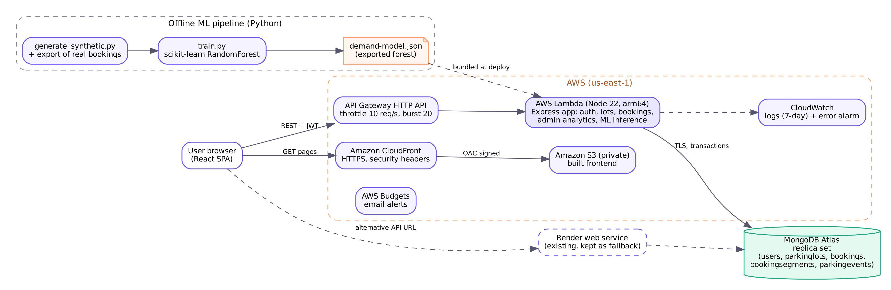

# Deploying ParkEase on AWS, and keeping it within the credits

> **Status:** these templates have been linted (`cfn-lint`) but **not deployed**. Nothing in this guide has been run against a real AWS account yet. Every command that creates a resource is marked 💲 and should only be run after the owner approves it.

## 1. Target architecture



| Part | Service | Template |
|---|---|---|
| Frontend | S3 bucket (private, encrypted) served by CloudFront with Origin Access Control and AWS's managed security-headers policy | `infra/frontend.yaml` |
| API + ML inference | One Lambda function (Node.js 22, arm64, 512 MB, 15 s timeout) running the Express app through `serverless-http`, behind an API Gateway **HTTP API** throttled to 10 req/s (burst 20) | `infra/backend.yaml` (AWS SAM) |
| Database | MongoDB Atlas free cluster (billed by MongoDB, not AWS) | set up in Atlas |
| Logs and alerts | CloudWatch Logs (7-day retention), one CloudWatch alarm on Lambda errors | `infra/backend.yaml` |
| Cost guard | AWS Budgets with email alerts at 20% and 80% of actual and 100% of forecast | `infra/budget.yaml` |
| Fallback | Existing Render web service, unchanged | — |

Why this shape: every part is pay-per-use and scales to zero, so an idle college demo costs close to nothing. There is no EC2 server, NAT Gateway, load balancer or SageMaker endpoint, which are the usual ways small projects burn credits.

**Secrets.** `MONGODB_URI` and `JWT_SECRET` are passed as `NoEcho` CloudFormation parameters and stored as Lambda environment variables, which Lambda encrypts at rest. Anyone with Lambda console access to the account can read them, so do not share the AWS account. (AWS Secrets Manager would cost $0.40 per secret per month and is not needed here.)

## 2. Cost estimate

Prices checked on 2026-10-23 from AWS pricing pages (sources at the end). Assumed demo load: 20,000 API calls per month, 300 ms average duration, 2 MB frontend, under 1 GB of logs.

| Service | Pricing used | Free allowance | Estimated cost / month |
|---|---|---|---|
| Lambda (arm64) | $0.20 per 1M requests; $0.0000133334 per GB-second | 1M requests and 400,000 GB-s per month (always free) | **$0.00** (uses 3,000 GB-s) |
| API Gateway HTTP API | $1.00 per 1M requests | 1M/month for 12 months on legacy free-tier accounts only | **≈ $0.02** |
| CloudFront | pay-as-you-go | 1 TB transfer + 10M requests per month (always free) | **$0.00** |
| S3 | about $0.023 per GB-month + request fees | — | **< $0.01** |
| CloudWatch Logs + 1 alarm | about $0.50 per GB ingested | 5 GB logs and 10 alarm metrics per month | **$0.00** |
| AWS Budgets (alerts only) | free | — | **$0.00** |
| MongoDB Atlas free cluster | not AWS | 512 MB storage, 100 ops/s | **$0.00** |
| **Total** | | | **about $0.03 per month** |

Even at 100× the assumed traffic (2M calls a month) the estimate stays under $5 a month. The real risks are not this architecture but mistakes: leaving an EC2 instance, NAT Gateway, RDS/DocumentDB database or SageMaker endpoint running can cost from several dollars to tens of dollars a month each (a NAT Gateway alone is about $0.045 per hour, roughly $32 a month). The budget alert in step 3 exists to catch exactly that.

### Credits: what to check first

AWS has two programmes ([AWS News Blog](https://aws.amazon.com/blogs/aws/aws-free-tier-update-new-customers-can-get-started-and-explore-aws-with-up-to-200-in-credits)):

- **Accounts created on or after 15 July 2025, Free plan:** up to $200 credits; the plan ends after 6 months or when credits run out, whichever is first; you are not charged until you upgrade to a paid plan. Some services are not available on the Free plan.
- **Paid plan or older accounts:** promotional credits are applied to eligible charges first, and anything not covered is charged to the card on file.

Before deploying, open **Billing and Cost Management → Credits** and note: remaining balance, expiry date, and the list of services the credit applies to. Credits generally do not cover everything (for example AWS Marketplace purchases, some support plans, and taxes, depending on the credit's terms). **Do not assume a charge is covered; the budget alert counts usage before credits.**

## 3. Step-by-step deployment

Prerequisites, all free: AWS CLI v2 and AWS SAM CLI installed; an IAM user or IAM Identity Center user for deployment (not the root user) with MFA; Atlas cluster with a database user and network access.

### 3.1 💲 Budget alert first (free, but it is an AWS resource)

```bash
aws cloudformation deploy --region us-east-1 --stack-name parkease-budget \
  --template-file infra/budget.yaml \
  --parameter-overrides Email=you@example.com MonthlyLimitUsd=5
```

Confirm the subscription email AWS sends. Also enable **Billing preferences → Free Tier usage alerts**.

### 3.2 💲 Backend (Lambda + HTTP API)

```bash
cd infra
sam build --template-file backend.yaml
sam deploy --guided --stack-name parkease-api --region us-east-1 --capabilities CAPABILITY_IAM
#   MongoUri:     your Atlas URI
#   JwtSecret:    node -e "console.log(require('crypto').randomBytes(48).toString('hex'))"
#   ClientOrigin: http://localhost:5173  (updated in 3.4)
#   AppTimezone:  e.g. Asia/Kolkata
```

Note the `ApiBaseUrl` output. Then run once against Atlas, from `backend/` with `.env` pointing at Atlas:

```bash
npm run db:init && npm run seed
```

### 3.3 💲 Frontend (S3 + CloudFront)

```bash
aws cloudformation deploy --region us-east-1 --stack-name parkease-web --template-file infra/frontend.yaml
aws cloudformation describe-stacks --stack-name parkease-web --query "Stacks[0].Outputs" --output table

cd frontend
VITE_API_BASE_URL=<ApiBaseUrl> npm run build
aws s3 sync dist/ s3://<BucketName>/ --delete
aws cloudfront create-invalidation --distribution-id <DistributionId> --paths "/*"
```

The first CloudFront invalidation paths each month are free (1,000 paths); `/*` counts as one.

### 3.4 Allow the CloudFront origin in CORS

```bash
cd infra && sam deploy --stack-name parkease-api --parameter-overrides ClientOrigin=https://<SiteUrl-domain> --no-confirm-changeset
```

(Keep the other parameters by answering the prompts again, or pass them all.)

## 4. Validating the deployment

Run each check and record the actual output; do not record a check as passed unless it was run.

| Check | Command / action | Expected |
|---|---|---|
| Health | `curl <ApiBaseUrl>/health` | `200`, `"database":"connected"`, model version |
| CORS allowed | `curl -I -H "Origin: https://<site>" <ApiBaseUrl>/lots` | `access-control-allow-origin: https://<site>` |
| CORS refused | same with `Origin: https://evil.example` | no `access-control-allow-origin` header |
| Security headers | `curl -I https://<site>` | `strict-transport-security`, `x-content-type-options` |
| Throttling | send ~50 requests in a second | some `429` responses |
| Latency | `API=<ApiBaseUrl> EMAIL=... PASSWORD=... node backend/scripts/latency.js 50` | record p50/p95 |
| End to end | `APP_URL=https://<site> ADMIN_EMAIL=... ADMIN_PASSWORD=... node e2e/smoke.cjs` | `errors []` |
| Concurrency on Atlas | `MONGODB_URI=<atlas> node backend/scripts/race-demo.js 20 5` | `parkease.roundsWithDoubleBooking: 0` |
| Logs | CloudWatch → Log groups → `/aws/lambda/parkease-api` | request logs, no stack traces |

## 5. Monitoring the budget

- **Billing and Cost Management → Bills:** charges so far this month, by service, before and after credits.
- **Cost Explorer:** daily cost grouped by service. Anything other than Lambda, API Gateway, S3, CloudFront, CloudWatch is a red flag.
- **Credits page:** remaining balance; check weekly.
- **Budget emails:** at $1 (20% of $5) investigate immediately.
- **Lambda → Monitor:** invocations, errors, duration; the `parkease-api-errors` alarm shows red after any error.

## 6. Clean-up (removes everything this guide created)

```bash
aws s3 rm s3://<BucketName> --recursive          # a bucket must be empty before deletion
aws cloudformation delete-stack --stack-name parkease-web
sam delete --stack-name parkease-api              # also removes the SAM artifacts bucket contents it created
aws cloudformation delete-stack --stack-name parkease-budget   # optional; budgets are free
```

Then check **CloudFormation → Stacks** (none left), **S3** (no `parkease`/`aws-sam-cli-managed` buckets you no longer need), **CloudWatch → Log groups** (delete `/aws/lambda/parkease-api` if it remains), and **Billing → Bills** the next day.

## 7. Things that need you (manual steps)

- Approve the deployment and confirm the credit balance, expiry and plan type.
- Create the deployment IAM user / Identity Center access with MFA and configure `aws configure`.
- Confirm the AWS Budgets subscription email.
- Rotate the Atlas password and JWT secret that were included in the uploaded zip, and put the new values only into SAM parameters and Render's environment settings.

## Sources

- AWS Free Tier update, 2025: https://aws.amazon.com/blogs/aws/aws-free-tier-update-new-customers-can-get-started-and-explore-aws-with-up-to-200-in-credits
- AWS What's New, July 2025: https://aws.amazon.com/about-aws/whats-new/2025/07/aws-free-tier-credits-month-free-plan/
- API Gateway pricing: https://aws.amazon.com/api-gateway/pricing/
- Lambda pricing summary: https://cloudburn.io/blog/aws-lambda-pricing
- CloudFront pricing: https://aws.amazon.com/cloudfront/pricing/pay-as-you-go
- CloudWatch pricing: https://aws.amazon.com/cloudwatch/pricing/
- AWS Budgets pricing: https://aws.amazon.com/aws-cost-management/aws-budgets/pricing
- Atlas free cluster limits: https://mongodb.com/docs/atlas/reference/free-shared-limitations/
