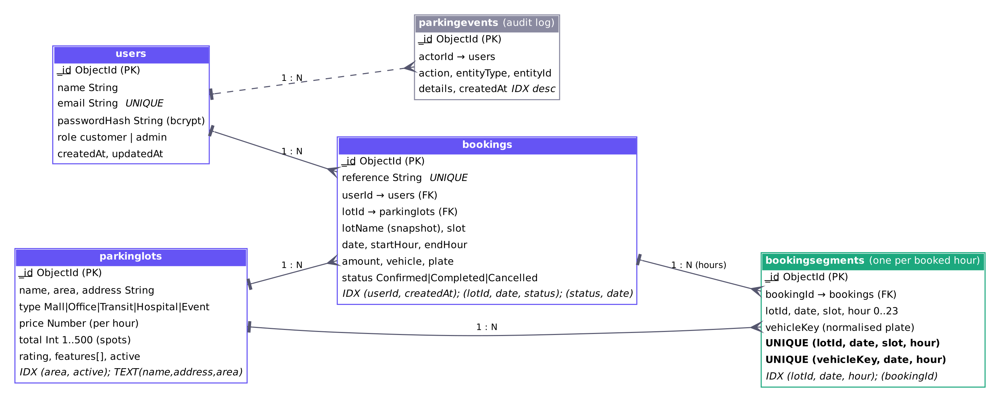
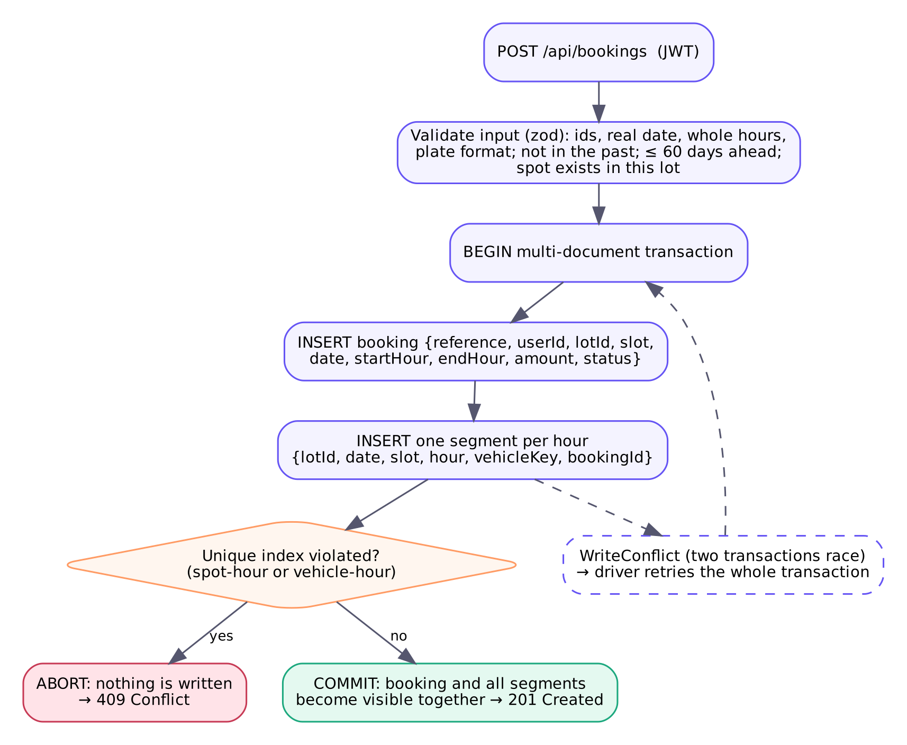

# Database design (MongoDB)



MongoDB is a document database, so there are no SQL tables or foreign-key constraints. ParkEase still applies the relational ideas the course covers: each collection holds one entity type, references between entities are `ObjectId` fields (like foreign keys), and the important integrity rules are enforced by the database itself through unique indexes, transactions and `$jsonSchema` validators, not only by application code.

## Collections

| Collection | Entity | Key fields | Relationships |
|---|---|---|---|
| `users` | Account | `email` (unique, lower-case), `passwordHash` (bcrypt, cost 12), `role` | 1 user : N bookings, N audit events |
| `parkinglots` | Parking location | `type` (enum), `price` per hour, `total` spots (1..500), `active` | 1 lot : N bookings, N segments |
| `bookings` | Reservation | `reference` (unique), `userId`, `lotId`, `slot`, `date`, `startHour`, `endHour`, `amount`, `status` | N : 1 user, N : 1 lot, 1 : N segments |
| `bookingsegments` | One occupied hour of one spot | `lotId`, `date`, `slot`, `hour`, `vehicleKey`, `bookingId` | N : 1 booking |
| `parkingevents` | Audit log | `actorId`, `action`, `entityType`, `entityId`, `details` | N : 1 user |

`bookings.lotName` is a deliberate denormalised snapshot: a receipt keeps the name the lot had when it was booked, even if the lot is renamed later.

Spot ids (`A-01` ... `A-10`, `B-01` ...) are derived from `total` in rows of ten, so the spots always match the lot's capacity and do not need their own collection.

### Sample documents (from the local test database)

```js
// bookings
{ reference: 'PK-261023-1BM4MZ', userId: ObjectId(...), lotId: ObjectId(...), lotName: 'Sunset Plaza Garage',
  slot: 'A-01', date: '2026-10-23', start: '17:00', end: '19:00', startHour: 17, endHour: 19,
  amount: 100, vehicle: 'Sedan', plate: 'KA 01 AB 1234', status: 'Confirmed', createdAt: ISODate(...) }

// bookingsegments (this booking has two: hour 17 and hour 18)
{ lotId: ObjectId(...), date: '2026-10-23', slot: 'A-01', hour: 17, vehicleKey: 'KA01AB1234', bookingId: ObjectId(...) }
```

## Preventing overlapping and duplicate bookings

A booking from 09:00 to 12:00 is stored as one `bookings` document plus three `bookingsegments` documents (hours 9, 10 and 11). Two unique indexes on the segments turn the business rules into database constraints:

| Index | Rule it enforces |
|---|---|
| `uniq_spot_hour` UNIQUE `(lotId, date, slot, hour)` | A spot cannot be reserved twice for the same hour, so two bookings of the same spot cannot overlap |
| `uniq_vehicle_hour` UNIQUE `(vehicleKey, date, hour)` (partial: only documents that have a `vehicleKey`) | One vehicle cannot hold two spots at the same time (stops duplicate bookings from double clicks or two tabs) |
| `reference_1` UNIQUE on `bookings.reference` | Every booking has a distinct reference |
| `email_1` UNIQUE on `users.email` | One account per email, even when two sign-ups race |

The booking and all of its segments are inserted in **one multi-document transaction** (`session.withTransaction`, `backend/src/routes/bookings.js`):



- **Atomicity:** if any segment violates a unique index, the transaction aborts and the booking document disappears too. There is never a booking with only some of its hours.
- **Consistency:** the unique indexes and validators are checked on every write.
- **Isolation:** MongoDB transactions use snapshot isolation. When two transactions write the same index key, one gets a `WriteConflict` (a transient error) and the driver retries it; on retry it sees the committed segment and fails with a duplicate-key error, which the API returns as `409 Conflict`.
- **Durability:** Atlas commits with majority write concern (`w=majority` in the connection string), so a committed booking survives the loss of one node.

Why not "check whether the spot is free, then insert"? Between the check and the insert another request can do the same check. The experiment below shows that this naive approach double-books every time under load.

Cancelling a booking runs in a transaction too: it sets `status: 'Cancelled'` and deletes the booking's segments, so the hours become free at the same moment the booking is cancelled.

### Concurrency control choice

This is **optimistic** concurrency control: nothing is locked in advance; conflicts are detected at commit time by the unique index. It suits parking because most requests do not collide. Pessimistic locking (for example a "lock" document per spot) would serialise all requests for a lot and add a cleanup problem when a client crashes while holding a lock.

## Other integrity rules

| Rule | Where |
|---|---|
| Required fields, types, enums, number ranges | Mongoose schemas (`backend/src/models.js`) and `$jsonSchema` validators added by `npm run db:init` (`validationLevel: moderate`) |
| Bookings cannot start in the past (in the network's timezone `APP_TIMEZONE`) and at most 60 days ahead | API |
| Spot must exist in the lot (`A-01` ... up to `total`) | API |
| A lot's capacity cannot be reduced below a spot that still has upcoming bookings | `PATCH /lots/:id` |
| Lots are archived (`active: false`), never deleted, so old bookings keep a valid reference | `DELETE /lots/:id` |
| Only bookings that have not started can be cancelled | API |
| Past bookings become `Completed` automatically before bookings are read | `completePastBookings()` |
| Every change is recorded in `parkingevents` | API |

## Indexes and why each exists

| Collection | Index | Used by |
|---|---|---|
| users | `email` unique | login, sign-up |
| parkinglots | `(area, active)` | area filter |
| parkinglots | text `(name, address, area)` | `?q=` search |
| bookings | `reference` unique | integrity |
| bookings | `(userId, createdAt desc)` | "my bookings" |
| bookings | `(lotId, date, status)` | upcoming bookings per lot (archive check) |
| bookings | `(status, date)` | marking past bookings `Completed` |
| bookingsegments | `uniq_spot_hour`, `uniq_vehicle_hour` | integrity |
| bookingsegments | `(lotId, date, hour)` | availability map, live "free now" counts |
| bookingsegments | `bookingId` | cancelling a booking |
| parkingevents | `createdAt desc` | audit log |

`GET /api/admin/db/explain` returns MongoDB's query plan for the availability query, so the index use can be shown live during a demo.

## CRUD

| Operation | Examples |
|---|---|
| Create | register, create lot, create booking (+ segments), audit events |
| Read | list/search lots, availability, booking history, admin reports |
| Update | edit lot, edit profile name, cancel booking (status), mark bookings `Completed` (`updateMany`) |
| Delete | delete segments on cancel; lots use soft delete (an update) to keep referential integrity |

## Aggregation queries

All admin figures are computed by the database with aggregation pipelines (`backend/src/routes/admin.js`):

```js
// Bookings per status (summary)
db.bookings.aggregate([{ $group: { _id: '$status', count: { $sum: 1 } } }])

// Revenue and booked hours per lot, joined to the lot details ($lookup = join)
db.bookings.aggregate([
  { $match: { status: { $ne: 'Cancelled' } } },
  { $group: { _id: '$lotId', bookings: { $sum: 1 }, revenue: { $sum: '$amount' },
              hours: { $sum: { $subtract: ['$endHour', '$startHour'] } } } },
  { $lookup: { from: 'parkinglots', localField: '_id', foreignField: '_id', as: 'lot' } },
  { $unwind: '$lot' },
  { $project: { name: '$lot.name', type: '$lot.type', bookings: 1, revenue: 1,
                avgHoursPerBooking: { $round: [{ $divide: ['$hours', '$bookings'] }, 2] } } },
  { $sort: { revenue: -1 } }
])

// Occupied spot-hours by hour of day over the last N days (hourly occupancy chart)
db.bookingsegments.aggregate([
  { $match: { date: { $gte: '2026-10-17', $lte: '2026-10-23' } } },
  { $group: { _id: '$hour', occupiedSpotHours: { $sum: 1 } } },
  { $sort: { _id: 1 } }
])
```

`backend/scripts/export-occupancy.js` uses the same kind of aggregation to export real hourly occupancy for retraining the ML model.

## Measured results

Both experiments ran on 2026-10-23 against MongoDB 7.0 in Docker (single-node replica set) on a 4-vCPU cloud container. They have **not** been repeated on Atlas.

**1. Race experiment** (`node scripts/race-demo.js 50 20`): 50 clients try to book the same spot and hour at the same moment, 20 rounds. Raw output: [results/race.json](results/race.json).

| Approach | Rounds with a double booking | Most winners in one round | Total winners (ideal: 20) |
|---|---|---|---|
| Naive "check then insert" | 20 of 20 | 50 | 539 |
| ParkEase (unique index + transaction) | 0 of 20 | 1 | 20 (0 orphan bookings) |

**2. Index experiment** (`node scripts/index-benchmark.js 200000`): the availability query over 200,000 synthetic segments, median of 5 runs. Raw output: [results/index.json](results/index.json).

| Plan | Documents examined | Index keys examined | Results | Median time |
|---|---|---|---|---|
| Collection scan (forced) | 200,000 | 0 | 38 | 89 ms |
| `lot_date_hour` index | 38 | 38 | 38 | 0 ms (below 1 ms resolution) |
