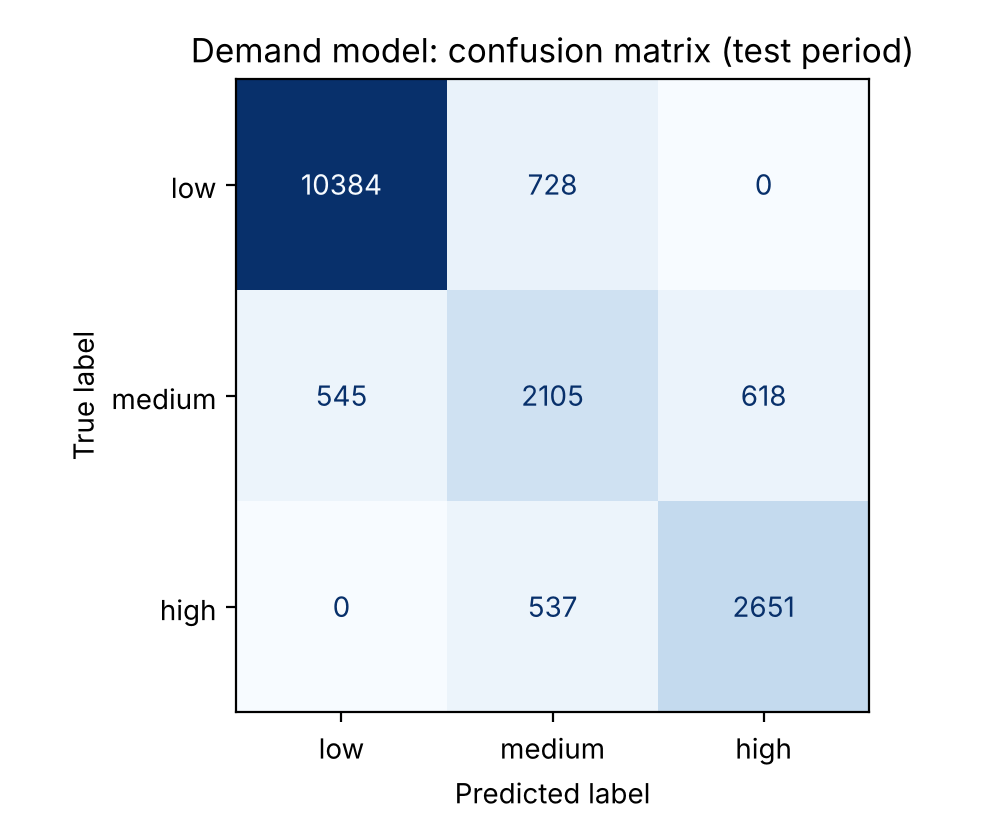
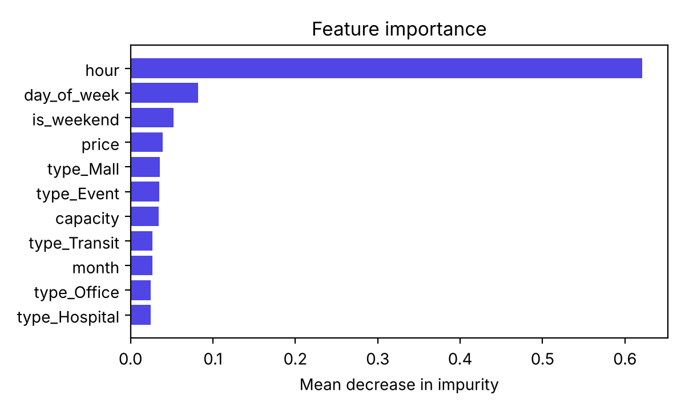

# Parking-demand prediction

## What it predicts

For a parking lot, a date and an hour, the model predicts whether demand will be **low** (under 40% of spots occupied), **medium** (40% to under 75%) or **high** (75% or more). The API returns all 24 hours of a date, and the booking page shows them as a bar strip with the user's chosen hours highlighted.

The prediction is **advice only**. It is computed by a separate endpoint (`/api/predictions/demand`) and never used to accept, refuse or price a booking. Real availability comes from the `bookingsegments` collection, and booking validity is enforced by database constraints (see [DATABASE.md](DATABASE.md)). A test checks that requesting predictions does not change availability.

## Data

ParkEase does not yet have enough real bookings to learn from, so the model is trained on **synthetic data** from `ml/generate_synthetic.py`. Every row has `source = "synthetic"`, and the UI, API and admin page all say so.

The simulator covers 12 lots (the 6 seeded lots plus 6 extra synthetic lots with other sizes and prices) for every hour of 2025: 105,120 rows. Its assumptions, all written in the script:

- each lot type has a weekday and weekend hourly occupancy profile (offices busy 09:00 to 17:00 on weekdays, malls busiest on weekend afternoons, transit busy on weekday commuting hours, hospitals steady in the daytime, event venues busy on Friday and Saturday evenings);
- prices above $30 lower demand slightly;
- malls are busier in December, offices quieter in August and late December;
- a random per-day effect and per-hour noise, then occupied spots drawn from a binomial distribution.

Class shares over the whole year: 64.1% low, 18.1% medium, 17.8% high (test period: 63.3% low, 18.6% medium, 18.2% high).

When real bookings accumulate, `node backend/scripts/export-occupancy.js > ml/data/real_occupancy.csv` exports real hourly occupancy, and `python train.py --real ml/data/real_occupancy.csv` trains on both. Rows keep their `source` label, and the model metadata reports how many of each were used.

## Features

`hour`, `day_of_week` (Mon = 0), `is_weekend`, `month`, `capacity`, `price`, and a one-hot `type_*` for the five lot types. The lot's id is deliberately not a feature, so the model works for new lots an admin creates.

## Training (`ml/train.py`)

- **Split by time:** train on 2025-01-01 to 2025-10-31 (87,552 rows), test on 2025-11-01 to 2025-12-31 (17,568 rows) that the model never saw. A random split would leak information between neighbouring hours.
- **Model:** `RandomForestClassifier`, 60 trees, `class_weight="balanced"` (medium and high are rarer than low).
- **Tuning:** grid search over `max_depth` ∈ {8, 12, 16} and `min_samples_leaf` ∈ {5, 20} with 3-fold `TimeSeriesSplit` on the training period, scored by macro F1. Best: `max_depth=16`, `min_samples_leaf=20` (cross-validated macro F1 0.785).
- **Baseline:** always predict the most frequent class ("low").

## Results on the test period

Raw numbers: [results/ml-metrics.json](results/ml-metrics.json). Produced by `python train.py` on 2026-10-23 with scikit-learn 1.9.1.

| Model | Accuracy | Macro F1 | Weighted F1 |
|---|---|---|---|
| Most-frequent baseline | 0.6325 | 0.2583 | n/a |
| Random Forest | **0.8618** | **0.7992** | 0.8630 |

| Class | Precision | Recall | F1 | Support |
|---|---|---|---|---|
| low | 0.950 | 0.935 | 0.942 | 11,112 |
| medium | 0.625 | 0.644 | 0.634 | 3,268 |
| high | 0.811 | 0.832 | 0.821 | 3,188 |

Confusion matrix (rows = actual, columns = predicted):

| | low | medium | high |
|---|---|---|---|
| **low** | 10,384 | 728 | 0 |
| **medium** | 545 | 2,105 | 618 |
| **high** | 0 | 537 | 2,651 |



Errors are almost all between neighbouring classes; low is never confused with high. "Medium" is hardest because it is a narrow band between two thresholds and the simulator's daily noise pushes hours across them.

Most important features (mean decrease in impurity): `hour` 0.621, `day_of_week` 0.082, `is_weekend` 0.052, `price` 0.039, `type_Mall` 0.035, `type_Event` 0.035, `capacity` 0.034; the remaining features are each under 0.03.



**How to read these numbers:** they show the model recovers the patterns the simulator was built with. They are not evidence of how well it would predict a real car park. That needs real occupancy data.

## Inference in production

Running scikit-learn on Lambda would need a second, Python function packaged with NumPy, SciPy and scikit-learn (a large bundle that has to fit Lambda's 250 MB unzipped limit or be shipped as a container image), and a SageMaker endpoint would bill for every hour it runs. Both add cost and latency for a model this small. So `train.py` exports each tree as plain arrays (feature index, threshold, left child, right child, leaf class probabilities) into `backend/src/ml/demand-model.json` (about 3.5 MB). `backend/src/ml/predictor.js` walks each tree exactly as scikit-learn does (`x[feature] <= threshold` goes left) and averages the leaf probabilities, which is what `predict_proba` does for a Random Forest.

A parity test (`backend/tests/unit.test.js`) runs 300 held-out rows through both: every predicted class matches scikit-learn, and the largest probability difference is under 0.0001 (from rounding leaf values to 5 decimals).

Measured locally: 24 predictions for one lot take about 5 ms per API call (median, including the database lookup of the lot). See [results/latency.json](results/latency.json).

## Security of the endpoint

`/api/predictions/*` requires a signed-in user, validates `lotId` and `date`, and is rate-limited to 60 requests per minute per client.

## Retraining and deployment

```bash
cd ml && pip install -r requirements.txt
python generate_synthetic.py                 # or add --real with exported data
python train.py                              # updates the model JSON, reports and parity fixtures
cd ../backend && npm test                    # parity test must pass
```

Then redeploy the backend (the model file is bundled with the code). The model version (`YYYYMMDD-1`) is shown by `/api/health` and the admin page.

## Limitations

- Trained on synthetic data only; real-world accuracy is unknown.
- No weather, holidays, local events or recent-booking trend features.
- Thresholds (40% / 75%) are a design choice, not learned.
- One model for all lots; very unusual lots may be predicted poorly.
- The prediction does not update as bookings come in during the day.

Future work: retrain on exported real occupancy, add holiday and weather features, compare against gradient boosting, and monitor drift between predicted and actual occupancy.
